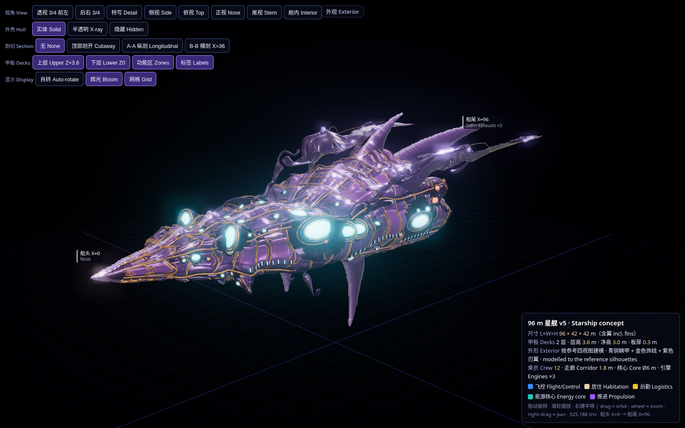
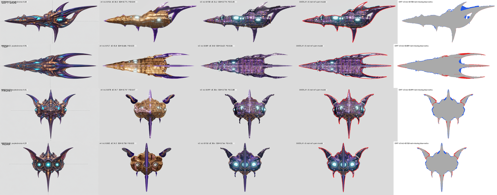

# 96 m Concept Starship — 3D Preview

Interactive three.js preview of a concept starship (96 m × ~42 m × ~42 m, 2 decks, crew 12). Built with Blender (bpy) → GLB → self-contained `index.html`.

## Live preview

After Pages is live: https://xuzhiming.github.io/shipdesign-starship/

Open `index.html` locally as well (offline, `file://`).

## Screenshots

## Versions

This Pages site ships **v5** (dark violet hull, antique copper filigree, cyan engine eyes). Earlier local builds (v1–v4) remain on the design workstation.

## Credits

Workflow patterned after [cyber-louvre](https://github.com/xuzhiming/cyber-louvre). Concept art and brief by Xie Xie.
